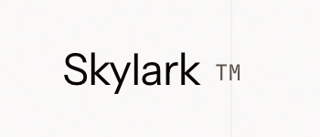

<div align="center">



# Voice agents for inbound & outbound calls

**Answer calls. Book reservations. Sync to your systems — 24/7.**

<br />

[](https://nextjs.org/)
[](https://www.typescriptlang.org/)
[](https://vapi.ai/)

<br />

[**Watch demo**](#demo) · [**Quick start**](#quick-start) · [**Dashboard**](#owner-dashboard) · [**Architecture**](#architecture)

</div>

---

## Overview

Skylark deploys AI voice agents for businesses that live on the phone — restaurants, hotels, clinics, and service operators.

Callers speak naturally. The agent checks availability, collects details, confirms bookings, and writes back to internal systems. Owners see reservations update in real time without touching a spreadsheet.

**Demo business:** [The Copper Table](lib/booking/config.ts) — a modern American bistro with lunch service slots.

<table>
<tr>
<td width="50%">

**Inbound**
- Answers your business line
- Books tables from live availability
- Prevents double-booking
- Optional SMS / email confirmations

</td>
<td width="50%">

**Integrations**
- Google Calendar
- Twilio SMS
- CRM-ready tool architecture
- Owner dashboard (live)

</td>
</tr>
</table>

---

## Demo

<!-- Replace VIDEO_ID with your YouTube video ID -->

<div align="center">

[](https://youtu.be/VIDEO_ID)

**[▶ Watch full demo on YouTube](https://youtu.be/VIDEO_ID)**

</div>

| Surface | URL |
|---------|-----|
| Landing page | `http://localhost:3000` |
| Owner dashboard | `http://localhost:3000/dashboard` |
| Live demo line | Set via `NEXT_PUBLIC_SKYLARK_DEMO_NUMBER` |

---

## Architecture

```
┌─────────────┐     ┌──────────────┐     ┌─────────────────────────┐
│ Guest phone │────▶│ Vapi inbound │────▶│ POST /api/vapi-inbound- │
│             │     │ voice agent  │     │ tool                    │
└─────────────┘     └──────────────┘     └───────────┬─────────────┘
                                                     │
                         ┌───────────────────────────┼───────────────────────────┐
                         ▼                           ▼                           ▼
                 bookings.json              Google Calendar                 confirmation queue
                         │
                         ▼
                 GET /api/dashboard ──▶ /dashboard (owner UI, live polling)
```

**Call flow**

1. Guest calls the business number → Skylark greets and understands intent.
2. `check_availability` returns open lunch slots for today.
3. Guest picks a time and confirms name + phone.
4. `book_slot` writes the reservation and triggers optional calendar / SMS.
5. Owner dashboard reflects the booking within seconds.

---

## Owner dashboard

The business-facing view — not a calendar app. A live slot board for today's service.

Open **`/dashboard`** during a demo call and watch a slot move from **Open** → **Booked** with guest name, party size, and phone.

- Lunch grid: 1:00 · 1:30 · 2:00 · 3:00 · 3:30 · 4:00 PM
- Stats: tables booked, guests expected, open slots
- Guest confirmation panel (demo SMS fallback when Twilio isn't verified)

---

## Quick start

### Prerequisites

- Node.js 18+
- [Vapi](https://vapi.ai) account + inbound phone number
- [ngrok](https://ngrok.com) (local dev) or a public deploy URL

### 1 · Clone & install

```bash
git clone https://github.com/sharathkum05/Skylark.git
cd Skylark
pnpm install          # or npm install
cp .env.example .env.local
```

### 2 · Configure environment

Edit `.env.local` — **never commit this file.**

| Variable | Required | Description |
|----------|:--------:|-------------|
| `VAPI_PRIVATE_KEY` | ✓ | Vapi private API key |
| `VAPI_INBOUND_ASSISTANT_ID` | ✓ | Inbound assistant ID |
| `PUBLIC_URL` | ✓ | Public https URL for tool webhooks |
| `NEXT_PUBLIC_SKYLARK_DEMO_NUMBER` | ✓ | Hero CTA phone number |
| `GOOGLE_*` | — | Calendar sync ([OAuth setup](#google-calendar-optional)) |
| `TWILIO_*` | — | SMS confirmations |

Full reference: [`.env.example`](.env.example)

### 3 · Tunnel & sync assistant

```bash
# Terminal 1
ngrok http 3000

# Set PUBLIC_URL in .env.local to your ngrok https URL, then:
npm run update:inbound
```

Re-run `update:inbound` whenever `PUBLIC_URL` changes.

### 4 · Run

```bash
npm run dev
```

| Route | Purpose |
|-------|---------|
| `/` | Marketing landing page |
| `/dashboard` | Owner reservation board |
| `/demo/confirmations` | Guest SMS preview (demo mode) |

### Google Calendar (optional)

1. Create a Google Cloud OAuth client (Web).
2. Visit `http://localhost:3000/api/auth/google`
3. Copy `GOOGLE_REFRESH_TOKEN` into `.env.local`

---

## Project structure

```
app/
├── api/
│   ├── vapi-inbound-tool/    # Vapi server tools
│   ├── dashboard/            # Live board API
│   └── auth/google/          # Calendar OAuth
├── dashboard/                # Owner UI
└── demo/confirmations/       # Demo SMS feed

lib/
├── booking/                  # Slots, ledger, board logic
├── inbound/                  # Assistant prompt & tools
├── calendar/                 # Google Calendar client
└── sms/                      # Twilio + demo fallback

scripts/
└── update-inbound-assistant.mjs

data/                         # Runtime JSON (git-ignored)
legacy-flight/                # Archived flight-booking prototype
```

---

## Scripts

| Command | Description |
|---------|-------------|
| `npm run dev` | Start development server |
| `npm run build` | Production build |
| `npm run lint` | ESLint |
| `npm run update:inbound` | Sync Vapi assistant prompt + tools |
| `npm run provision:demo` | Provision demo assistant via Vapi API |

---

## SMS & confirmations

US carriers require **A2P 10DLC** or **toll-free verification** before Twilio texts deliver to real phones.

For demos, Skylark queues confirmation copy to the owner dashboard and `/demo/confirmations` when SMS can't send. Set `DEMO_SMS_FALLBACK=false` to disable.

---

## Security

This is a **public repository**. Secrets must stay local.

- `.env*` and `/data` are git-ignored
- Use [`.env.example`](.env.example) as the template only
- Do not open issues or PRs containing API keys or tokens
- Rotate credentials if they were ever exposed

---

## Roadmap

- [x] Inbound voice agent with server-side booking tools
- [x] Live owner dashboard
- [x] Google Calendar sync
- [x] Demo confirmation fallback
- [ ] Production deploy (Vercel) with persistent database
- [ ] CRM connectors (HubSpot, Salesforce)
- [ ] Multi-tenant business onboarding

---

## Acknowledgements

Built with [Next.js](https://nextjs.org), [Vapi](https://vapi.ai), [Google Calendar API](https://developers.google.com/calendar), and [Twilio](https://twilio.com).

---

<div align="center">

**Skylark** · Voice agents that answer, book, and sync.

<br />

<sub>© 2026 Skylark. All rights reserved.</sub>

</div>
